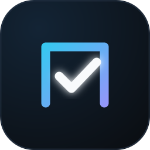
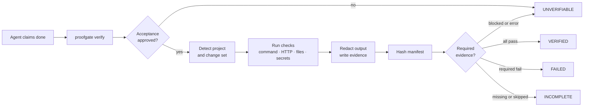
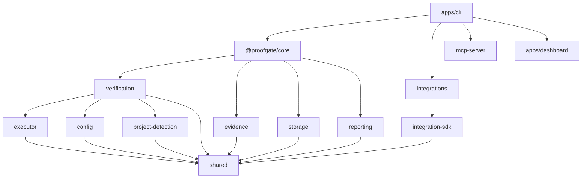

<div align="center">
  
  <h1>ProofGate</h1>
  <p><strong>AI wrote it. Prove it works.</strong></p>
  <p>Independent verification for AI coding agents.<br />
  Real commands. Human-owned acceptance. Hash-manifested evidence.</p>
  <p>
    <a href="LICENSE"></a>
    <a href="https://nodejs.org"></a>
    
    
  </p>
</div>

> **Alpha.** The verification engine is implemented and typechecked. The CLI, MCP server, and dashboard are in progress. Command examples below describe the interface being built; no package has been published yet. See [Project status](#project-status) for the exact state.

---

## The 30-second version

| The usual agent loop | With ProofGate |
| --- | --- |
| The agent says the tests pass. | ProofGate runs them and records the exit code, output, and duration. |
| The agent decides what "done" means. | A human approves the acceptance criteria; the approval is hashed per profile. |
| A failure becomes a paragraph. | A failure becomes `FAIL`, with findings, evidence, and a non-zero exit code. |
| "Green" is a claim. | `VERIFIED` is a rule. |

## Why

Coding agents are optimized to finish. That makes them excellent at producing the shape of a completed task: a diff, a summary, a confident sentence about tests passing.

The problem is that the claim and the evidence come from the same place. The agent decides what to run, interprets the result, and reports it. A skipped test, a swallowed error, or a criterion quietly redefined in the prompt all look like success from the outside.

ProofGate separates the two:

- **The agent makes the change.**
- **ProofGate runs the verification.**
- **A human owns the definition of done.**

No model sits in the verdict path. The result is a function of commands that actually ran, files that actually exist, and criteria a human actually approved.

## What you get

- **Real execution.** Checks are `argv` arrays executed without a shell, with timeouts, output limits, dependency ordering, and captured `stdout` / `stderr`.
- **More than tests.** Command checks, HTTP probes, file and artifact assertions, and secret scans share one plan and one verdict.
- **Human-owned acceptance.** `.proofgate/acceptance.yaml` is hashed into a per-profile approval. If the criteria change, the run becomes `UNVERIFIABLE` until a human re-approves.
- **Evidence bundles.** Every run writes redacted logs, structured results, and a SHA-256 manifest under `.proofgate/runs/<run-id>/`.
- **One honest status.** `VERIFIED`, `FAILED`, `INCOMPLETE`, or `UNVERIFIABLE`, with exit codes that agents and CI can branch on.
- **Local-first.** No account, no API key, no telemetry, no upload. SQLite is optional; the JSON index is always available.

## How it works



1. **Define the plan.** A human writes the checks in `.proofgate/config.yaml` and the task-specific definition of done in `.proofgate/acceptance.yaml`.
2. **Approve the intent.** `proofgate criteria approve` records the acceptance document, check set, required flags, profiles, and policy as a hash in `.proofgate/acceptance.lock.json`.
3. **Run the gate.** ProofGate detects the project, reads the change set, builds a profile-specific plan, and executes it from the project root.
4. **Capture the evidence.** Output is redacted before it is persisted. Every evidence file is hashed into a manifest, and the report embeds the manifest hash.
5. **Derive the verdict.** Required checks and criteria determine the overall status. There is no manual override and no "probably fine" path.

## The status contract

Green is a claim. These are the definitions.

| Check status | Meaning |
| --- | --- |
| `PASS` | The check ran and every expectation was met. |
| `FAIL` | The check ran and an expectation was not met. |
| `UNKNOWN` | The check produced no reliable verdict. |
| `SKIPPED` | The check was excluded by profile, applicability, a failed dependency, or a guard. |
| `BLOCKED` | Policy prevented execution, for example unapproved acceptance or a forbidden path. |
| `ERROR` | ProofGate or the environment could not execute the check. |

| Overall status | Exit | Meaning |
| --- | --- | --- |
| `VERIFIED` | `0` | Every required check passed and every required criterion has evidence. |
| `FAILED` | `1` | A required check or criterion failed. |
| `INCOMPLETE` | `2` | Required evidence is missing or skipped, a required manual sign-off is absent, or an optional check failed under `policy.optionalFailures: block`. |
| `UNVERIFIABLE` | `3` | Acceptance is not approved, policy blocked the run, or a required check could not run (`BLOCKED` / `ERROR`). |

`SKIPPED` and `UNKNOWN` never count as success. A plan with no checks is `UNVERIFIABLE`, not `VERIFIED`. A required `ERROR` is an infrastructure problem, so it is `UNVERIFIABLE` rather than a failed test.

## What it checks

| Type | What it proves | Details |
| --- | --- | --- |
| `command` | A process ran and produced the expected result. | `argv` only, no shell; `cwd`; `env`; expected exit codes; `stdout` / `stderr` regex; timeout; dependency order. |
| `http` | An endpoint answered as expected. | Status codes and response-body assertions. Loopback only unless `allowRemote: true`. |
| `files` | Artifacts exist, or do not, at the expected size. | Positive globs, `minBytes`, `maxBytes`, `mustNotExist`. |
| `secret-scan` | The change set contains no credentials. | Built-in plus custom patterns, an allowlist, and a per-file size cap. Never cached. |

Command checks are cached only after a real `PASS`. A cache hit is bound to the exact check definition, profile, intent, config, changed-file tree, resolved tool and version, lockfiles, project root, environment, and Node/platform — not just a timestamp.

## Acceptance is human-owned

`config.yaml` describes *how* to verify. `acceptance.yaml` describes *what done means* for the current task.

```yaml
version: 1
task: Add rate limiting to the public API

criteria:
  - id: tests-cover-limiter
    description: Rate-limit behavior is covered by tests
    kind: check
    check: test
    required: true

  - id: build-succeeds
    description: The production build succeeds
    kind: check
    check: build
    required: true

  - id: bundle-exists
    description: The build produced a non-empty bundle
    kind: artifact
    artifacts: ["dist/**/*.js"]
    required: true

  - id: human-review
    description: A human reviewed the diff and the evidence bundle
    kind: manual
    required: false
```

Approval is a separate, human action. The lock stores one intent hash per verification profile because each profile runs a different set of checks. Editing the acceptance document, the check set, a required flag, a profile assignment, or the failure policy invalidates the approval.

Two guards enforce the boundary:

- `guards.protectAcceptance` (default `true`) refuses to verify when the current intent is not approved.
- `guards.forbiddenPaths` and `guards.maxChangedFiles` stop a run before execution when the diff crosses a boundary a human set.

Agents are instructed, in `AGENTS.md` and their native integration files, not to edit `.proofgate/acceptance.yaml`, `.proofgate/acceptance.lock.json`, or the evidence directory.

## Evidence, not log files

```
.proofgate/runs/run_01j...
├── checks/
│   ├── typecheck-3f9c2a.stdout.log
│   ├── typecheck-3f9c2a.stderr.log
│   └── typecheck-3f9c2a.json
├── summary.json
├── manifest.json
└── run.json
```

The manifest lists every evidence file with its relative path, byte size, and SHA-256 hash. `run.json` is deliberately excluded: the report embeds the manifest hash, so covering the report would create a hash fixed point. The evidence writer can re-hash a bundle and report missing, modified, size-mismatched, or unexpected files.

Output is redacted for common credential shapes **before** it is written to disk. Evidence never leaves the machine. The only network calls are HTTP checks you explicitly configure.

Retention defaults to 100 runs and 90 days. The store uses `node:sqlite` when the running Node build exposes it and falls back to `.proofgate/index.json`; `run.json` is always the authoritative record.

## Integrations

| Integration | MCP | Automatic completion check | Scope | Notes |
| --- | --- | --- | --- | --- |
| **Claude Code** | Yes | Yes — `Stop` hook | project / user | Run `/hooks` once to review and trust the hook. |
| **Claude Desktop** | Yes | No | user | MCP only; restart the app after installing. |
| **Codex CLI** | Yes | No | project / user | MCP plus `AGENTS.md` guidance; hook trust is left to the user. |
| **OpenCode v1** | Yes | Yes — plugin on `session.idle` | project / user | Reports asynchronously; reinstall after a major upgrade. |
| **OpenCode v2** | Yes | Yes — `Plugin.define` | project / user | Reports asynchronously; reinstall after a major upgrade. |
| **Cursor** | Yes | Partial — stop hook | project / user | Hook behavior varies by Cursor version. |
| **Gemini CLI** | Yes | Yes — `AfterAgent` hook | project / user | Hook output is strict JSON; ProofGate complies. |
| **Windsurf** | Yes | No | user | No documented hook API, so verification is on demand. |
| **Generic CLI** | Optional | Optional wrapper | project | Writes instructions, an `AGENTS.md` block, and an optional hook wrapper. |
| **Universal MCP** | Yes | No | project | Portable `.mcp.json` entry for any MCP-capable client. |

Integration installs are non-destructive:

- Writes are atomic and take a timestamped backup first.
- A failed install rolls back every file it already changed.
- JSONC, TOML, and Markdown are edited surgically; unrelated keys, comments, and sections are preserved.
- Uninstall removes only ProofGate-managed entries.
- Hooks invoke generated Node wrappers under `.proofgate/hooks/`, using `node` directly instead of a shell or a `.cmd` shim.

## Configuration

```yaml
version: 1

project:
  name: my-app

verification:
  profile: balanced
  changedProfile: fast
  ignorePaths:
    - "docs/**"

checks:
  - id: typecheck
    title: TypeScript
    type: command
    run: ["pnpm", "typecheck"]
    required: true
    profiles: ["fast", "balanced", "thorough"]
    timeoutSeconds: 300

  - id: test
    title: Unit tests
    type: command
    run: ["pnpm", "test", "--", "--run"]
    required: true
    profiles: ["balanced", "thorough"]
    dependsOn: ["typecheck"]

  - id: build
    title: Production build
    type: command
    run: ["pnpm", "build"]
    required: true
    profiles: ["thorough"]

  - id: api-health
    title: Local API health
    type: http
    url: "http://127.0.0.1:3000/health"
    expectStatus: [200]
    required: false
    profiles: ["thorough"]

  - id: no-secrets
    title: Secret scan
    type: secret-scan
    paths: ["**/*"]
    required: true
    profiles: ["fast", "balanced", "thorough"]

  - id: bundle
    title: Build artifacts
    type: files
    files:
      - pattern: "dist/**/*.js"
        minBytes: 1
    required: true
    profiles: ["thorough"]

policy:
  onFailure: report      # report | block
  optionalFailures: block # block | warn
  retryLimit: 2

limits:
  timeoutSeconds: 600
  maxParallelChecks: 4
  maxOutputBytes: 2097152

cache:
  enabled: true
  maxEntries: 500
  maxAgeDays: 30

retention:
  maxRuns: 100
  maxAgeDays: 90
```

Profiles are cumulative in intent: `fast` is the quick gate, `balanced` adds the main suite, and `thorough` is the release gate. A check can opt out of any profile.

## CLI

The target interface is small on purpose.

| Command | Purpose |
| --- | --- |
| `proofgate init` | Detect the project, propose checks, write config and acceptance, and install agent instructions. |
| `proofgate verify` | Run the plan, write evidence, print the verdict, and return its exit code. |
| `proofgate status` | Show the latest run, active lock, acceptance approval, and cache state. |
| `proofgate report` | Render a stored run as terminal, JSON, Markdown, HTML, or GitHub output. |
| `proofgate ui` | Open the local dashboard. |
| `proofgate doctor` | Diagnose the environment, config, tools, and integrations. |
| `proofgate setup` | Guided setup for agents and CI. |
| `proofgate integrations` | Add, remove, list, or diagnose agent integrations. |
| `proofgate config` | Read, validate, and explain configuration. |
| `proofgate criteria` | List, diff, and approve acceptance criteria. |
| `proofgate update` | Update ProofGate and migrate project state. |
| `proofgate uninstall` | Remove integrations and local ProofGate state. |
| `proofgate mcp` | Run the stdio MCP server. |

The core verification loop will be:

```sh
proofgate init
proofgate criteria approve
proofgate verify --changed
proofgate report --format html --open
```

`verify` exits non-zero for every status except `VERIFIED`, so a hook, script, or CI job cannot accidentally treat missing evidence as success.

## Project status

Implemented and typechecked:

- [x] Strict TypeScript workspace, package boundaries, and build setup
- [x] Config schema, loader, explain output, intent hashing, acceptance lock
- [x] Project, ecosystem, tool, and Git change detection
- [x] Safe `argv` executor with timeouts, output capture, and truncation
- [x] Verification planner, scheduler, dependency handling, cache, guards
- [x] Command, HTTP, files, and secret-scan evaluators
- [x] Acceptance criteria evaluation and overall-status derivation
- [x] Evidence writer, SHA-256 manifest, bundle verification, retention
- [x] Run storage with SQLite and JSON fallback
- [x] Terminal, JSON, Markdown, HTML, and GitHub reporting
- [x] JSON Schemas for run reports, run lists, and evidence manifests
- [x] Integration SDK: atomic edits, backups, rollback, JSONC/TOML, hook wrappers
- [x] Adapters for Claude Code, Claude Desktop, Codex, OpenCode v1/v2, Cursor, Gemini, Windsurf, generic CLI, and universal MCP

In progress:

- [ ] `@proofgate/core` orchestration layer
- [ ] MCP server built on the official SDK
- [ ] CLI commands and hook-format output
- [ ] Local dashboard API and React UI
- [ ] Unit, integration, end-to-end, and security test suites
- [ ] Reusable GitHub Action and CI/release workflows
- [ ] Standalone binaries, checksums, and published packages
- [ ] Full documentation set and examples

## Architecture



| Package | Responsibility | State |
| --- | --- | --- |
| `@proofgate/shared` | Types, statuses, constants, hashing, redaction, paths, text utilities | Implemented |
| `@proofgate/config` | Zod schema, YAML loading, intent hashing, acceptance locking | Implemented |
| `@proofgate/project-detection` | Ecosystem, package manager, tools, workspaces, Git changes | Implemented |
| `@proofgate/executor` | Shell-free process execution, output collection, binary resolution | Implemented |
| `@proofgate/verification` | Planning, checks, cache, guards, criteria, status derivation | Implemented |
| `@proofgate/evidence` | Redacted evidence bundles, manifests, verification, pruning | Implemented |
| `@proofgate/storage` | Run persistence, SQLite/JSON backends, retention | Implemented |
| `@proofgate/reporting` | Terminal, JSON, Markdown, HTML, GitHub, JSON Schemas | Implemented |
| `@proofgate/integration-sdk` | Atomic writes, backups, rollback, JSONC/TOML, hook wrappers | Implemented |
| `@proofgate/integrations` | Ten agent adapters and a registry | Adapters written |
| `@proofgate/core` | End-to-end orchestration and public operations | In progress |
| `@proofgate/mcp-server` | Stdio MCP tools for agents | In progress |
| `apps/cli` | Commander CLI, prompts, hook formatting | In progress |
| `apps/dashboard` | React/Vite/Tailwind local UI | In progress |

## Design decisions

- **No shell.** Commands are argument arrays. There is no string interpolation, no glob expansion by a shell, and no quoting bugs.
- **No model in the verdict.** The engine is deterministic. AI can propose a plan; it cannot approve one or change a verdict.
- **Acceptance is a hash, not a convention.** The lock binds the document, the check set, the profiles, and the policy to a per-profile intent.
- **Evidence before reporting.** Redaction happens at write time. Reports are projections of stored evidence, not a second source of truth.
- **SQLite is an accelerator.** `run.json` is authoritative. A corrupt or unavailable database never loses a run.
- **Integrations are guests.** Every edit is reversible, scoped, and backed up. Unrelated configuration is preserved.
- **Honest limitations.** Where a provider has no hook API or requires explicit trust, the integration says so instead of pretending.

## Development

Requirements: Node.js 22 or newer and pnpm 9 or newer.

```sh
git clone https://github.com/a-kio/ProofGate.git
cd ProofGate
corepack enable
pnpm install
```

Check an implemented package:

```sh
pnpm --filter @proofgate/verification typecheck
pnpm --filter @proofgate/reporting build
```

The full workspace build will be wired once the CLI and dashboard entry points exist. Until then, build and test packages individually.

Repository layout:

```
apps/
  cli/                 Commander CLI (in progress)
  dashboard/           React/Vite dashboard (in progress)
packages/
  shared/              Types, constants, hashing, redaction
  config/              Schema, loading, intent, acceptance lock
  project-detection/   Ecosystem and Git detection
  executor/            Safe process execution
  verification/        Plan, run, cache, criteria, status
  evidence/            Evidence bundles and manifests
  storage/             Run persistence
  reporting/           Terminal, JSON, Markdown, HTML, GitHub
  integration-sdk/     Reversible config editing
  integrations/        Agent adapters
  core/                Orchestration (in progress)
  mcp-server/          MCP tools (in progress)
```

## Contributing

Read [CONTRIBUTING.md](CONTRIBUTING.md). The short version: keep the verdict deterministic, keep statuses honest, add a test for behavior you change, and never make a failing check look green.

## Security

ProofGate executes commands from a project-owned config file. Treat that file with the same care as a `Makefile` or a CI workflow. Report vulnerabilities through [GitHub Security Advisories](https://github.com/a-kio/ProofGate/security/advisories/new); see [SECURITY.md](SECURITY.md).

## License

Apache-2.0. See [LICENSE](LICENSE) and [NOTICE](NOTICE).

---

<p align="center"><sub>Built by <a href="https://github.com/a-kio">A-kio</a>. If an agent should not be able to lie about being done, star the repo.</sub></p>
